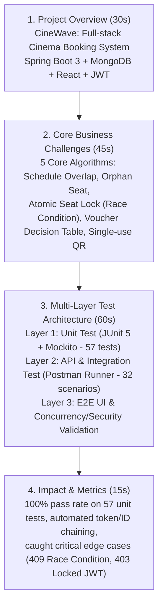

# INTERVIEW SCRIPT: "Can you walk me through your CineWave project and its test architecture?"

Tài liệu này cung cấp kịch bản trả lời phỏng vấn chuẩn **QA / SDET / Automation Tester** (có cả **bản Tiếng Anh** và **bản Tiếng Việt**, chia theo cấu trúc 4 phần: *Project Overview -> Core Business Logic -> Multi-Layer Test Architecture -> Key Results*).

---

## 1. Cấu trúc trả lời 4 bước (Dàn ý nhớ nhanh trong 30 giây)

Khi nhà tuyển dụng hỏi *"Can you walk me through your CineWave project and its test architecture?"*, bạn hãy trả lời theo mô hình **Kim tự tháp Kiểm thử (Test Pyramid)**:

---

## 2. Bản trả lời Tiếng Anh (English Spoken Script — 2 phút)

### Step 1: Project Overview (Tổng quan dự án)
> *"Certainly! **CineWave** is a full-stack Cinema Ticket Booking and Theater Management system built with **Java Spring Boot 3**, **MongoDB**, **Spring Security with JWT**, and a **React + TypeScript** frontend.*
>
> *The system serves three roles: **Customers** (browsing movies, selecting seats on a 56-seat interactive map, applying vouchers, and paying), **Theater Staff** (scanning single-use QR tickets at the gate), and **Admins** (managing movies, scheduling showtimes across multiple cinema halls, and managing users and vouchers)."*

### Step 2: Core Business Rules Under Test (Các bài toán nghiệp vụ cốt lõi)
> *"From a QA perspective, what makes CineWave really interesting is its **5 strict domain algorithms**:*
> 1. ***Showtime Interval Overlap Check***: *Preventing double-booking a cinema room by enforcing a 15-minute cleaning buffer (`newStart < existingEnd AND newEnd > existingStart`).*
> 2. ***The Orphan Seat Rule***: *Preventing customers from leaving a single isolated empty seat on the row edges or trapped between two selected/booked seats.*
> 3. ***Concurrency & Atomic Seat Locking***: *Holding seats for 10 minutes with a lazy-expiration mechanism and preventing race conditions when two users book the exact same seat simultaneously.*
> 4. ***Dynamic Pricing & Capped Voucher Engine***: *Calculating seat surcharges (`STANDARD`, `VIP +20%`, `COUPLE 2x +10k`) and applying `FIXED` or `PERCENT` vouchers with maximum discount caps.*
> 5. ***Single-Use QR Check-in & Real-Time RBAC Revocation***: *Ensuring a paid QR ticket can only be scanned once (`200 OK` first scan, `409 Conflict` second scan) and immediately blocking locked users (`403 Forbidden`) even if their JWT token hasn't expired yet."*

### Step 3: The Test Architecture (Kiến trúc kiểm thử 3 tầng)
> *"To validate these rules thoroughly, I designed a **3-layer Test Architecture** following the Testing Pyramid:*
>
> * **Layer 1 – White-Box Unit Testing (JUnit 5 & Mockito):**
>   *I wrote **57 isolated unit tests** across 5 test classes targeting the service and algorithm layer ([`VoucherServiceTest`](file:///d:/xem%20phim%20nè/cinema-booking-be/src/test/java/com/cinema/booking/service/VoucherServiceTest.java), [`ShowtimeServiceTest`](file:///d:/xem%20phim%20nè/cinema-booking-be/src/test/java/com/cinema/booking/service/ShowtimeServiceTest.java), [`OrphanSeatRuleTest`](file:///d:/xem%20phim%20nè/cinema-booking-be/src/test/java/com/cinema/booking/service/OrphanSeatRuleTest.java), [`PaymentServiceTest`](file:///d:/xem%20phim%20nè/cinema-booking-be/src/test/java/com/cinema/booking/service/PaymentServiceTest.java), and [`CinemaAlgorithmsUnitTest`](file:///d:/xem%20phim%20nè/cinema-booking-be/src/test/java/com/cinema/booking/CinemaAlgorithmsUnitTest.java)). I mocked MongoDB repositories and `MongoTemplate` to verify all **Boundary Values** (e.g., 0 seats, 8 seats, 9 seats; base price `< 50,000 VND`) and **Decision Table** combinations for vouchers in under 6 seconds.*
>
> * **Layer 2 – API & Integration Automation ([`cinema-booking-postman-collection.json`](file:///d:/xem%20phim%20nè/cinema-booking-postman-collection.json)):**
>   *At the API layer, I built an automated **Postman Collection Suite with 6 folders and 32 end-to-end API scenarios**. Using Postman's JavaScript sandbox (`pm.test` and `pm.collectionVariables`), the suite automatically logs in as Admin, Staff, Customer, and a Test-Lock User, extracts JWT tokens and dynamic resource IDs (`movieId`, `showtimeId`, `bookingId`, `qrCode`), chains them across requests, asserts HTTP status codes (`200`, `201`, `400`, `403`, `409`) and JSON payloads, and cleans up test data at the end.*
>
> * **Layer 3 – State Transition, Security & E2E UI Validation:**
>   *Finally, I tested full **State Transitions** of seats (`AVAILABLE -> LOCKED -> BOOKED` or back to `AVAILABLE` upon payment failure/10-minute timeout) and bookings (`PENDING -> PAID -> CHECKED_IN`), alongside UI verification on the React Customer Portal and Admin CMS."*

### Step 4: Summary / Key Impact (Kết quả đạt được)
> *"Thanks to this architecture, the entire backend regression suite runs in seconds via Maven (`mvn test`) and Postman Collection Runner, giving 100% coverage of all positive, negative, boundary, concurrency, and security edge cases."*

---

## 3. Bản trả lời Tiếng Việt (Dùng khi phỏng vấn bằng Tiếng Việt — 2 phút)

### Bước 1: Giới thiệu tổng quan dự án (Project Overview)
> *"Dạ, **CineWave** là hệ thống Đặt vé xem phim và Quản trị rạp chiếu phim Full-stack được xây dựng với Backend là **Java Spring Boot 3 + MongoDB + Spring Security (JWT)** và Frontend là **React + TypeScript**.*
>
> *Hệ thống phân tách thành 3 vai trò chính: **Customer** (xem phim, chọn ghế trên sơ đồ 56 ghế, áp mã giảm giá, thanh toán), **Staff** (nhân viên soát vé quét mã QR tại cổng rạp) và **Admin** (quản lý phim, xếp lịch chiếu cho các phòng rạp, quản lý voucher và khóa/mở khóa người dùng)."*

### Bước 2: Điểm nhấn nghiệp vụ cần kiểm thử (5 Thuật toán cốt lõi)
> *"Điểm đặc sắc nhất của dự án dưới góc nhìn QA là hệ thống xử lý **5 bài toán nghiệp vụ phức tạp**:*
> 1. ***Thuật toán chống trùng lịch chiếu (Interval Overlap)***: *Tự động cộng thêm 15 phút dọn rạp sau mỗi suất chiếu và chặn tạo lịch trùng giờ trong cùng một phòng chiếu (`409 Conflict`).*
> 2. ***Thuật toán chống ghế trống lẻ (Orphan Seat Rule)***: *Chặn người dùng chọn ghế làm chừa lại đúng 1 ghế trống đơn độc ở bìa hàng ghế hoặc kẹp giữa 2 ghế đã chọn/đã đặt (`400 Bad Request`).*
> 3. ***Thuật toán giữ ghế nguyên tử (Atomic Seat Lock & Lazy Expiration)***: *Khóa ghế trong 10 phút, tự động nhả ghế khi hết hạn và chống **Race Condition** khi 2 người bấm đặt cùng 1 ghế tại cùng một thời điểm (`409 Conflict`).*
> 4. ***Thuật toán tính giá động & Bảng quyết định Voucher (Decision Table)***: *Tính phụ thu theo hạng ghế (`STANDARD`, `VIP +20%`, `COUPLE x2 + 10k`) và kiểm tra 6 điều kiện của mã giảm giá (`FIXED`, `PERCENT` có giới hạn trần `maxDiscountAmount`, ngày hiệu lực, số lượt dùng, đơn tối thiểu).*
> 5. ***Soát vé QR dùng 1 lần & Thu hồi quyền tức thời (RBAC Security)***: *Mã QR chỉ cho phép check-in đúng 1 lần (`200 OK` lần đầu, `409 Conflict` lần thứ 2); đồng thời nếu Admin khóa tài khoản thì dù JWT Token của user còn hạn vẫn bị chặn ngay ở Filter với mã `403 Forbidden`."*

### Bước 3: Kiến trúc kiểm thử 3 tầng (Test Architecture)
> *"Để kiểm soát chất lượng toàn diện, em thiết kế kiến trúc kiểm thử theo **3 tầng của Kim tự tháp kiểm thử (Test Pyramid)**:*
>
> * **Tầng 1 – Unit Testing (White-Box Test với JUnit 5 & Mockito):**
>   *Em viết **57 Unit Tests** chia thành 5 class test chuyên biệt ([`VoucherServiceTest`](file:///d:/xem%20phim%20nè/cinema-booking-be/src/test/java/com/cinema/booking/service/VoucherServiceTest.java), [`ShowtimeServiceTest`](file:///d:/xem%20phim%20nè/cinema-booking-be/src/test/java/com/cinema/booking/service/ShowtimeServiceTest.java), [`OrphanSeatRuleTest`](file:///d:/xem%20phim%20nè/cinema-booking-be/src/test/java/com/cinema/booking/service/OrphanSeatRuleTest.java), [`PaymentServiceTest`](file:///d:/xem%20phim%20nè/cinema-booking-be/src/test/java/com/cinema/booking/service/PaymentServiceTest.java), [`CinemaAlgorithmsUnitTest`](file:///d:/xem%20phim%20nè/cinema-booking-be/src/test/java/com/cinema/booking/CinemaAlgorithmsUnitTest.java)). Bằng cách dùng Mockito cô lập tầng Database (`Repository` và `MongoTemplate`), bộ test kiểm tra toàn bộ **Giá trị biên (Boundary Value)** và **Bảng quyết định (Decision Table)** chỉ trong khoảng 5 giây.*
>
> * **Tầng 2 – API & Integration Testing (Postman Automation Suite):**
>   *Em xây dựng bộ Collection ([`cinema-booking-postman-collection.json`](file:///d:/xem%20phim%20nè/cinema-booking-postman-collection.json)) gồm **6 Folder với 32 kịch bản API**. Điểm mạnh của kiến trúc này là em sử dụng **API Chaining** bằng script `pm.test` và `pm.collectionVariables`: khi chạy **Collection Runner**, Postman tự động đăng nhập 4 role, trích xuất JWT Token và các ID động (`movieId`, `newShowtimeId`, `bookingId`, `qrCode`) truyền sang các bước tiếp theo, tự động assert HTTP Status Code (`200`, `201`, `400`, `403`, `409`), dữ liệu JSON trả về và tự động xóa dữ liệu rác (`Cleanup`) ở bước cuối cùng.*
>
> * **Tầng 3 – System / E2E & State Transition Testing:**
>   *Em kiểm thử sơ đồ chuyển đổi trạng thái (**State Transition**) của ghế (`AVAILABLE -> LOCKED -> BOOKED` hoặc quay về `AVAILABLE` khi thanh toán `FAILED`) và của đơn vé (`PENDING -> PAID -> CHECKED_IN`) trên cả API lẫn giao diện Web của khách hàng và trang CMS Admin."*

### Bước 4: Kết quả định lượng (Key Metrics)
> *"Nhờ kiến trúc 3 tầng này, 100% các luồng nghiệp vụ và edge case bảo mật đều được tự động hóa: **57/57 Unit Tests Pass** qua Maven và **32/32 kịch bản API Pass** tự động trên Postman Runner chỉ với 1 cú click."*

---

## 4. Bảng tóm tắt Kiến trúc Kiểm thử (Dùng để trình chiếu hoặc ôn nhanh trước phỏng vấn)

| Tầng kiểm thử (Test Layer) | Công cụ & Framework | Phạm vi kiểm thử (Scope) | Kỹ thuật thiết kế Test Case | Số lượng & File minh chứng |
| :--- | :--- | :--- | :--- | :--- |
| **1. Unit Test (Tầng Đơn vị)** | Java 17, **JUnit 5**, **Mockito**, Maven Surefire | Kiểm thử độc lập 5 thuật toán tại tầng `Service` (Mock `MongoRepository` & `MongoTemplate`) | - Boundary Value Analysis (BVA) - Equivalence Partitioning (EP) - Decision Table Testing | **57 Unit Tests** trong `src/test/java/com/cinema/booking/` ([`HUONG_DAN_UNIT_TEST.md`](file:///d:/xem%20phim%20nè/HUONG_DAN_UNIT_TEST.md)) |
| **2. API & Integration Test (Tầng Tích hợp)** | **Postman Collection Runner**, JavaScript (`pm.test`), OpenAPI/Swagger | Kiểm thử tích hợp Controller -> Security Filter -> Service -> MongoDB thật | - API Chaining (Token & ID) - Negative & Conflict Testing (`400`, `403`, `409`) - Concurrency Lock Simulation | **6 Folders / 32 Requests** ([`cinema-booking-postman-collection.json`](file:///d:/xem%20phim%20nè/cinema-booking-postman-collection.json)) |
| **3. E2E & UI Functional Test (Tầng Giao diện)** | React + Vite Web Portal (`/`) & Admin CMS (`/admin`) | Kiểm thử luồng người dùng đặt vé, chọn ghế trực quan, áp voucher, quản trị Admin | - State Transition Testing - Role-Based Access Control (RBAC) - Exploratory Testing | Giao diện Customer & Admin Dashboard ([`App.tsx`](file:///d:/xem%20phim%20nè/FE/src/App.tsx), [`SeatMap.tsx`](file:///d:/xem%20phim%20nè/FE/src/components/SeatMap.tsx)) |

