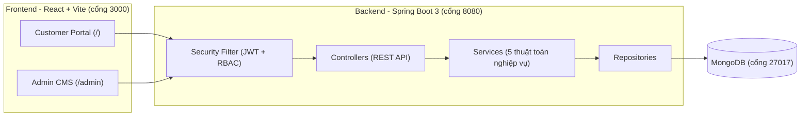
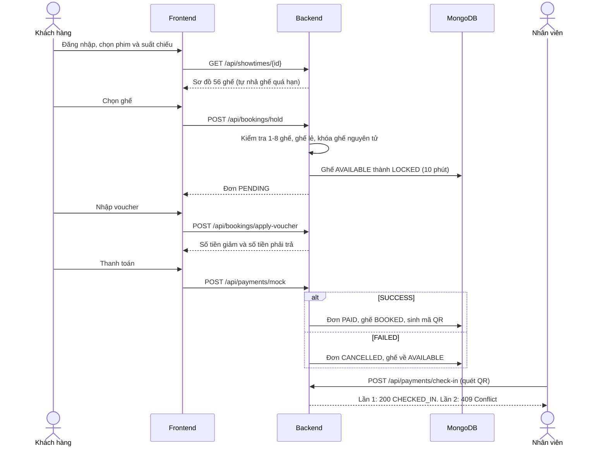
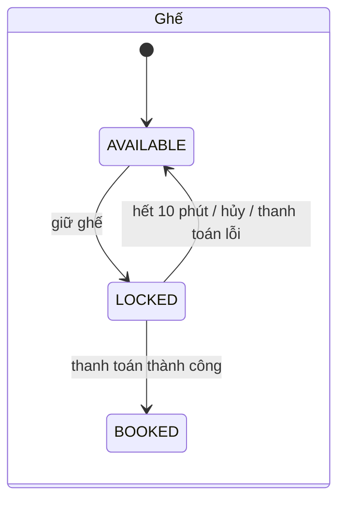
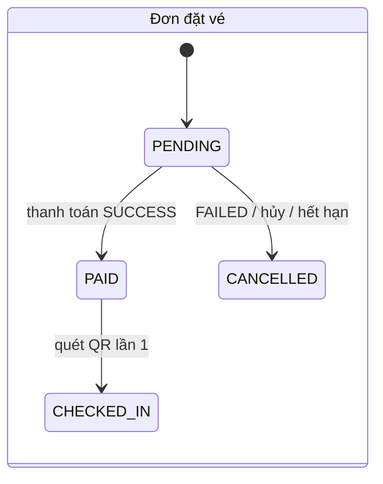

# 🎬 CineWave — Cinema Ticket Booking System

Hệ thống **đặt vé xem phim & quản trị rạp chiếu** full-stack.

| Thành phần | Công nghệ |
| :--- | :--- |
| Backend (`cinema-booking-be/`) | Java 17, Spring Boot 3, Spring Security + JWT, Spring Data MongoDB, springdoc-openapi |
| Frontend (`FE/`) | React 19, TypeScript, Vite, Tailwind CSS |
| Database | MongoDB (`mongodb://localhost:27017/cinema_booking_db`) |
| Testing | JUnit 5 + Mockito (57 unit tests), Postman Collection (32 kịch bản API) |

---

## 0. Giới thiệu hệ thống

### G1. CineWave là gì?

**CineWave** là hệ thống **đặt vé xem phim trực tuyến và quản trị rạp chiếu**. Khách hàng chọn phim, suất chiếu, ghế rồi thanh toán để nhận vé điện tử có mã QR. Nhân viên quét QR tại cổng rạp. Quản trị viên quản lý phim, lịch chiếu, voucher và người dùng.

Hệ thống giải quyết các bài toán thực tế của rạp phim:
- Tránh xếp **trùng lịch chiếu** trong cùng một phòng.
- Tránh **hai người đặt cùng một ghế** tại cùng thời điểm.
- Tránh để lại **ghế trống lẻ** gây lãng phí chỗ.
- Tính **giá vé** theo hạng ghế và áp **mã giảm giá**.
- Chống **dùng lại vé** và chặn tài khoản bị khóa ngay lập tức.

---

### G2. Hệ thống gồm những gì?



| Thành phần | Vai trò |
| :--- | :--- |
| **Customer Portal** | Duyệt phim, xem trailer, chọn suất chiếu, chọn ghế, áp voucher, thanh toán, xem lịch sử vé |
| **Admin CMS** | Dashboard, quản lý phim, suất chiếu, voucher, người dùng, đơn đặt vé |
| **Backend REST API** | Xử lý nghiệp vụ, xác thực JWT, phân quyền, validate dữ liệu |
| **MongoDB** | Lưu phim, suất chiếu (kèm 56 ghế), đơn đặt vé, voucher, người dùng |
| **Swagger UI** | Tài liệu API tương tác tại `/swagger-ui.html` |

### 3 vai trò người dùng

| Vai trò | Được làm gì |
| :--- | :--- |
| **CUSTOMER** | Xem phim, giữ ghế, áp voucher, thanh toán, hủy đơn, xem đơn của mình |
| **STAFF** | Quét QR check-in tại cổng, xem danh sách đơn |
| **ADMIN** | Toàn quyền: CRUD phim, suất chiếu, voucher; khóa/mở khóa người dùng; xem mọi đơn |

---

### G3. Hệ thống hoạt động như thế nào? (luồng chính)



### Các bước từ góc nhìn người dùng
1. **Đăng ký / đăng nhập** → nhận JWT token (hạn 24 giờ).
2. **Chọn phim** ở trang chủ, xem trailer, lọc theo định dạng.
3. **Chọn suất chiếu** → mở sơ đồ ghế (chỉ hiện khi đã chọn suất chiếu).
4. **Chọn ghế** → hệ thống giữ ghế 10 phút.
5. **Áp voucher** (tùy chọn) → xem số tiền sau giảm.
6. **Thanh toán** → nhận vé có mã QR.
7. **Đến rạp**, nhân viên quét QR để vào phòng chiếu.

---

### G4. Năm thuật toán nghiệp vụ cốt lõi

### 4.1. Chống trùng lịch chiếu (Admin tạo suất chiếu)
- `endTime = startTime + thời lượng phim + 15 phút dọn rạp`.
- Hai suất trùng nhau khi: `newStart < existingEnd AND newEnd > existingStart` trong cùng một phòng.
- Trùng lịch: `409 Conflict`. Giá vé gốc dưới 50.000đ: `400 Bad Request`.
- Tạo thành công thì tự sinh **56 ghế**: 32 STANDARD, 16 VIP, 8 COUPLE.

### 4.2. Chống ghế trống lẻ (Orphan Seat)
- Sau khi chọn, không được để đúng **1 ghế trống đơn độc** ở sát bìa hàng hoặc kẹp giữa các ghế đã chọn/đã đặt.
- Ví dụ: chọn `A2` làm trống lẻ `A1`, hoặc chọn `A1, A3` làm trống lẻ `A2`: `400 Bad Request`.

### 4.3. Giữ ghế nguyên tử và chống Race Condition
- Mỗi lần giữ từ **1 đến 8 ghế**.
- Ghế chuyển `AVAILABLE → LOCKED` trong **10 phút** (`app.booking.hold-duration-seconds = 600`).
- Hai người cùng đặt một ghế thì chỉ một người thành công, người còn lại nhận `409 Conflict`.
- Ghế hết hạn giữ được **nhả lười (lazy check)** khi có truy vấn tới suất chiếu đó.

### 4.4. Tính giá động và voucher
- Giá ghế: STANDARD theo giá gốc, VIP +20%, COUPLE gấp đôi cộng 10.000đ.
- Voucher `FIXED` (trừ cố định) hoặc `PERCENT` (có trần `maxDiscountAmount`).
- Bảng quyết định kiểm tra: voucher tồn tại, đang active, trong thời hạn, chưa hết lượt, đạt đơn tối thiểu. Vi phạm thì `400 Bad Request`.

### 4.5. QR dùng một lần và thu hồi quyền tức thời
- Thanh toán thành công sinh mã QR duy nhất.
- Quét lần 1: `200 OK`, đơn thành `CHECKED_IN`. Quét lần 2: `409 Conflict`.
- Admin khóa tài khoản thì mọi request kế tiếp của user bị chặn `403 Forbidden`, dù JWT chưa hết hạn.

---

### G5. Vòng đời dữ liệu (State Machine)





---

### G6. Bảo mật

- **Xác thực**: JWT (Bearer token) cấp khi đăng nhập.
- **Phân quyền (RBAC)**: kiểm tra role theo từng endpoint (CUSTOMER / STAFF / ADMIN).
- **Kiểm tra tài khoản mỗi request**: tài khoản bị khóa (`isActive = false`) bị chặn ngay.
- **Validate đầu vào**: Bean Validation (`@NotBlank`, `@Size`, `@Min`, `@Pattern`). Mật khẩu tối thiểu 8 ký tự, có chữ hoa, chữ thường và số.
- **Phản hồi thống nhất**: `{ code, message, data, timestamp }` và xử lý lỗi tập trung bằng `GlobalExceptionHandler`.

---

### G7. Dữ liệu và kiểm thử

- **Dữ liệu mẫu** tự seed lần chạy đầu: 16 phim, 19 suất chiếu (Cinema 01–04), 6 voucher, 4 tài khoản.
- **Unit Test**: JUnit 5 + Mockito, 57 tests cho các thuật toán (xem [HUONG_DAN_UNIT_TEST.md](HUONG_DAN_UNIT_TEST.md)).
- **API Test**: Postman Collection 6 folder, 32 kịch bản, tự động chuyền token/ID (xem [HUONG_DAN_POSTMAN.md](HUONG_DAN_POSTMAN.md)).

---

### G8. Hạn chế và hướng phát triển

- Thanh toán mới là **giả lập** (`/api/payments/mock`), chưa tích hợp cổng thật (VNPay, MoMo, Stripe).
- Chưa gửi email / SMS xác nhận vé.
- Có thể bổ sung: đẩy realtime trạng thái ghế (WebSocket), job nền dọn ghế hết hạn, báo cáo doanh thu, đa ngôn ngữ, CI/CD chạy test tự động.

> Cách cài đặt, chạy và các lưu ý xem [README.md](README.md).

---

## 1. Tính năng chính

- **Customer** (`http://localhost:3000/`): xem phim, trailer, chọn suất chiếu, chọn ghế trên sơ đồ 56 ghế, áp voucher, thanh toán (mock), xem lịch sử đặt vé.
- **Staff**: quét mã QR soát vé (mỗi vé chỉ dùng 1 lần).
- **Admin** (`http://localhost:3000/admin`): Dashboard, quản lý phim, suất chiếu, voucher, người dùng (khóa/mở khóa), danh sách đơn đặt vé.

### 5 thuật toán nghiệp vụ cốt lõi

| # | Thuật toán | Kết quả khi vi phạm |
| :-- | :--- | :--- |
| 1 | Chống trùng lịch chiếu cùng phòng (`newStart < existingEnd AND newEnd > existingStart`), `endTime = start + duration + 15 phút dọn rạp`; tự sinh 56 ghế | `409 Conflict` |
| 2 | Chống ghế trống lẻ (Orphan Seat) ở bìa hoặc giữa hàng | `400 Bad Request` |
| 3 | Giữ ghế nguyên tử (Atomic Lock) 10 phút, tối đa 8 ghế/lần, lazy-expiration, chống race condition | `409 Conflict` |
| 4 | Tính giá động theo hạng ghế + voucher `FIXED`/`PERCENT` (có trần giảm tối đa) | `400 Bad Request` |
| 5 | QR check-in dùng 1 lần; khóa tài khoản có hiệu lực ngay dù JWT còn hạn | `409` / `403 Forbidden` |

---

## 2. Cấu trúc thư mục

```text
.
├── cinema-booking-be/                  # Backend Spring Boot
│   ├── src/main/java/com/cinema/booking/   # controller, service, repository, dto, config, exception
│   ├── src/main/resources/application.yml  # Cấu hình (port, MongoDB, JWT, thời gian giữ ghế)
│   └── src/test/java/com/cinema/booking/   # 57 unit tests
├── FE/                                 # Frontend React + Vite
├── cinema-booking-postman-collection.json   # Postman Collection (API automation)
├── cinema-booking-postman-environment.json  # Postman Environment
├── start-all.ps1                       # Script khởi động nhanh (Windows)
├── HD.md                               # Đặc tả yêu cầu nghiệp vụ
├── HUONG_DAN_UNIT_TEST.md              # Hướng dẫn Unit Test
├── HUONG_DAN_POSTMAN.md                # Hướng dẫn Postman
├── CV_PROJECT_QA.md / INTERVIEW_QA_CINEWAVE.md / CACH_VIET_TAI_LIEU_QA_MARKDOWN.md  # Tài liệu QA
```

---

## 3. Yêu cầu môi trường

- **JDK 17+**
- **Maven 3.9+**
- **Node.js 18+** và npm
- **MongoDB** chạy ở `localhost:27017`
- (Tùy chọn) **Postman** để chạy bộ API test

---

## 4. Cài đặt & chạy

### 4.1. Khởi động MongoDB

```bash
mongod --dbpath ./.mongodb-data --port 27017 --bind_ip 127.0.0.1
```

### 4.2. Chạy Backend (`http://localhost:8080`)

```bash
cd cinema-booking-be
mvn spring-boot:run
# hoặc đóng gói rồi chạy JAR
mvn clean package
java -jar target/cinema-booking-be-1.0.0.jar
```

- Swagger UI: http://localhost:8080/swagger-ui.html
- OpenAPI JSON: http://localhost:8080/api-docs
- Lần chạy đầu, `DataInitializer` tự seed dữ liệu mẫu (16 phim, suất chiếu, 6 voucher, 4 user).

### 4.3. Chạy Frontend (`http://localhost:3000`)

```bash
cd FE
npm install
npm run dev
```

### 4.4. Chạy nhanh toàn bộ (Windows)

```powershell
./start-all.ps1
```

> ⚠️ `start-all.ps1` đang **hard-code đường dẫn** `mongod.exe` và `mvn.cmd` theo máy của tác giả. Hãy sửa biến `$mongodExe` và `$mvnCmd` trong file cho đúng máy của bạn trước khi chạy.

---

## 5. Tài khoản & voucher mẫu (dữ liệu seed)

| Role | Email | Mật khẩu |
| :--- | :--- | :--- |
| ADMIN | `admin@cinema.com` | `Admin@123` |
| STAFF | `staff@cinema.com` | `Staff@123` |
| CUSTOMER | `customer@cinema.com` | `Customer@123` |
| CUSTOMER (test khóa tài khoản) | `testlock@cinema.com` | `Test@1234` |

| Voucher | Ý nghĩa |
| :--- | :--- |
| `GIAM50K` | Giảm cố định 50.000đ, đơn tối thiểu 150.000đ |
| `CINEWAVE20` | Giảm 20%, tối đa 60.000đ, đơn tối thiểu 100.000đ |
| `VIP50PT` | Giảm 50%, tối đa 80.000đ, đơn tối thiểu 200.000đ |
| `EXPIRED10` | Đã hết hạn → `400` |
| `FUTURE50` | Chưa đến ngày áp dụng → `400` |
| `SOLDOUT99` | Hết lượt sử dụng → `400` |

---

## 6. API tổng quan

Mọi response có dạng:

```json
{ "code": 200, "message": "...", "data": {}, "timestamp": "..." }
```

| Nhóm | Endpoint chính |
| :--- | :--- |
| Auth | `POST /api/auth/register`, `POST /api/auth/login`, `GET /api/auth/me`, `GET /api/auth/users`, `PATCH /api/auth/users/{id}/status` |
| Movies | `GET/POST /api/movies`, `GET/PUT/DELETE /api/movies/{id}` |
| Showtimes | `GET/POST /api/showtimes`, `GET/DELETE /api/showtimes/{id}` |
| Bookings | `POST /api/bookings/hold`, `POST /api/bookings/apply-voucher`, `POST /api/bookings/{id}/cancel`, `GET /api/bookings/my-bookings`, `GET /api/bookings` |
| Vouchers | `GET/POST /api/vouchers`, `POST /api/vouchers/apply`, `DELETE /api/vouchers/{id}` |
| Payments | `POST /api/payments/mock`, `POST /api/payments/check-in` |

Gửi token ở header: `Authorization: Bearer <accessToken>`.

---

## 7. Kiểm thử

### Unit Test (JUnit 5 + Mockito — 57 tests)

```bash
mvn -f cinema-booking-be/pom.xml test
```

Chi tiết: [HUONG_DAN_UNIT_TEST.md](HUONG_DAN_UNIT_TEST.md).

### API Test (Postman)

1. Chạy Backend + MongoDB.
2. Import [cinema-booking-postman-collection.json](cinema-booking-postman-collection.json) và [cinema-booking-postman-environment.json](cinema-booking-postman-environment.json).
3. Chọn Environment → **Run collection**.

Chi tiết: [HUONG_DAN_POSTMAN.md](HUONG_DAN_POSTMAN.md).

### Type-check Frontend

```bash
npm --prefix FE run lint
```

---

## 8. ⚠️ Lưu ý quan trọng

1. **Bảo mật**: `jwt.secret` trong `application.yml` chỉ dùng cho demo. Khi triển khai thật, đưa vào biến môi trường / secret manager, **không commit secret thật**.
2. **Mật khẩu seed** (`Admin@123`, …) chỉ dùng cho môi trường dev/test, phải đổi hoặc xóa khi deploy.
3. **MongoDB bắt buộc phải chạy trước Backend**; nếu không Backend sẽ không khởi động được.
4. **Thứ tự chạy Postman**: chạy theo đúng thứ tự Folder 01 → 06 (các request dùng biến token/ID từ request trước). Có thể chạy lại nhiều lần nhờ bước cleanup & mở khóa user ở Folder 06.
5. **Ngày suất chiếu test** trong Postman (`2027-06-15`) phải nằm ở tương lai; nếu hệ thống validate quá khứ, hãy đổi ngày trong request 2.6 / 2.7.
6. **Thời gian giữ ghế** mặc định 600 giây (`app.booking.hold-duration-seconds`); ghế hết hạn được giải phóng theo cơ chế lazy-check khi truy vấn.
7. **Thanh toán là mock** (`/api/payments/mock`), chưa tích hợp cổng thanh toán thật.
8. **Dữ liệu MongoDB cục bộ** (`.mongodb-data/`) không được commit lên Git (đã khai báo trong `.gitignore`).
9. **Reset dữ liệu**: xóa database `cinema_booking_db` để seed lại từ đầu.
10. **Cổng mặc định**: Backend `8080`, Frontend `3000`, MongoDB `27017`. Đổi cổng thì cập nhật cả `baseUrl` ở Frontend (`FE/src/.../api-client.ts`) và Postman Environment, đồng thời kiểm tra cấu hình CORS của Backend.
11. Nếu chạy `mvn test` trong môi trường sandbox/CI hạn chế mà Mockito bị treo, giữ `forkCount=1` trong `pom.xml`.

---

## 9. Tài liệu liên quan


- [HD.md](HD.md) — Đặc tả nghiệp vụ
- [HUONG_DAN_UNIT_TEST.md](HUONG_DAN_UNIT_TEST.md)
- [HUONG_DAN_POSTMAN.md](HUONG_DAN_POSTMAN.md)
- [CV_PROJECT_QA.md](CV_PROJECT_QA.md)
- [INTERVIEW_QA_CINEWAVE.md](INTERVIEW_QA_CINEWAVE.md)

